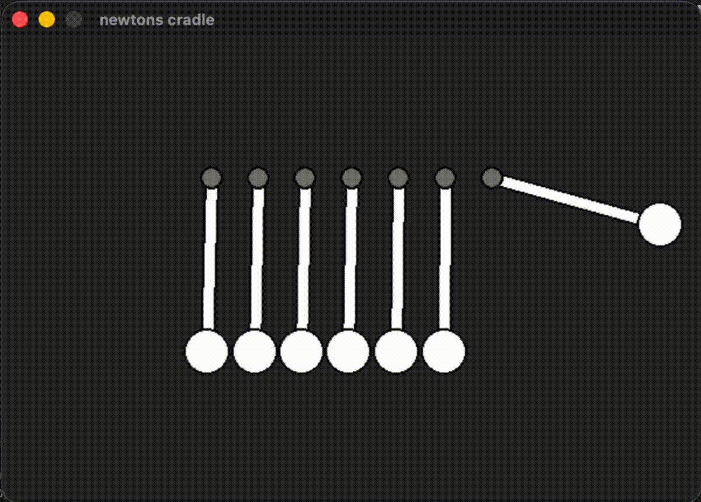

# Newtons Cradle Sim
A simple fun 2d newtons cradle simulator built in pygame.



## DESCRIPTION
This is a fun simple 2d newtons cradle simulator that allows you to play around with it by dragging the balls. 

## How To Install
1. go to the releases page [HERE](example.com)
2. download the executable for your specific operating system
3. run it 
4. depending on the os the anti virus may block the application from running because its unsigned. if that happens click "more info" and then "run away"
5. enjoy!

## Building From Source 
you may choose to build from source instead of using the provided executables. 

### Prerequisites
- python 3.10 or newer
- pip

### Steps
### 1. Clone the repo
```bash
git clone https://github.com/nurali-amirgali/newtons-cradle.git
```

### 2. Open the repo folder in the terminal
```bash
cd newtons-cradle
```
### 3. Install the required dependencies
```bash
pip install -r requirements.txt
```
### 4. Run the project
```bash
python main.py
```

## Controls
- ESC = quit
- P = pause
- R = reset
- Drag the balls to play with the cradle